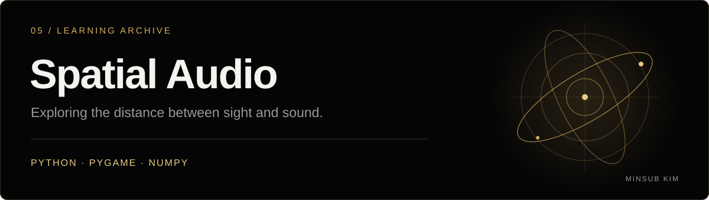

<!-- MINSUB-BRAND:START -->

  

  

  <a href="https://minsub-kim-portfolio.vercel.app/projects/spatial-audio/">프로젝트 스토리</a> · <a href="https://github.com/minsub1489">개발자 프로필</a> · <a href="https://minsub-kim-portfolio.vercel.app/">포트폴리오</a>

<!-- MINSUB-BRAND:END -->

---

## 거리 기반 오디오 실험

2D 음원과 청취점의 거리를 계산하고 재생 볼륨에 연결하는 게임프로그래밍입문 과제입니다.
음원의 원형 이동과 거리별 볼륨 변화를 [Spatial_Audio 소스](Project%233/Spatial_Audio)에서 확인할 수 있습니다.

# -GPI-Project-3
게임프로그래밍입문 Project#3 2022105447 김민섭
